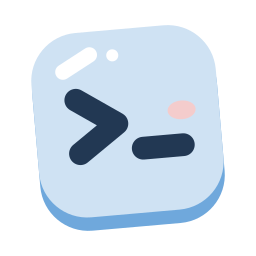
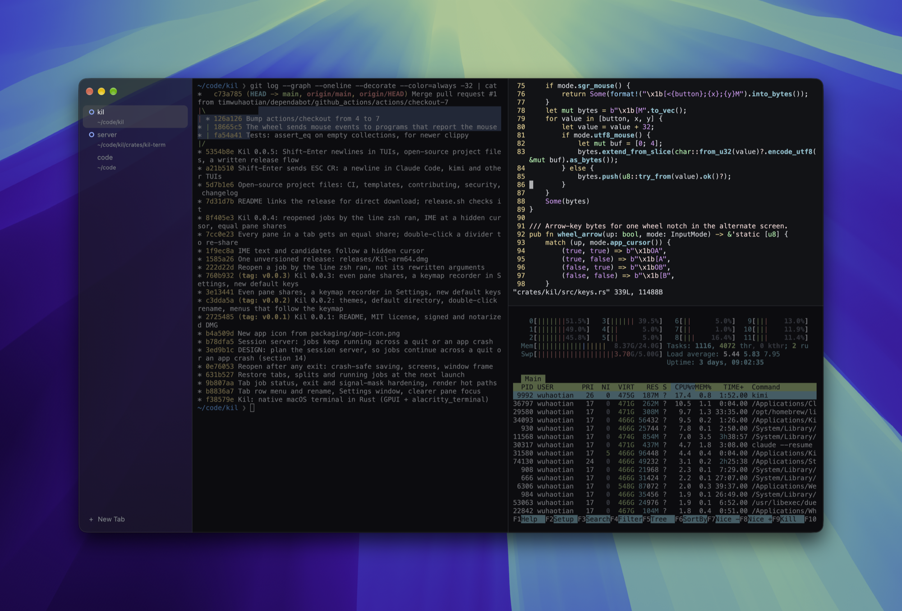
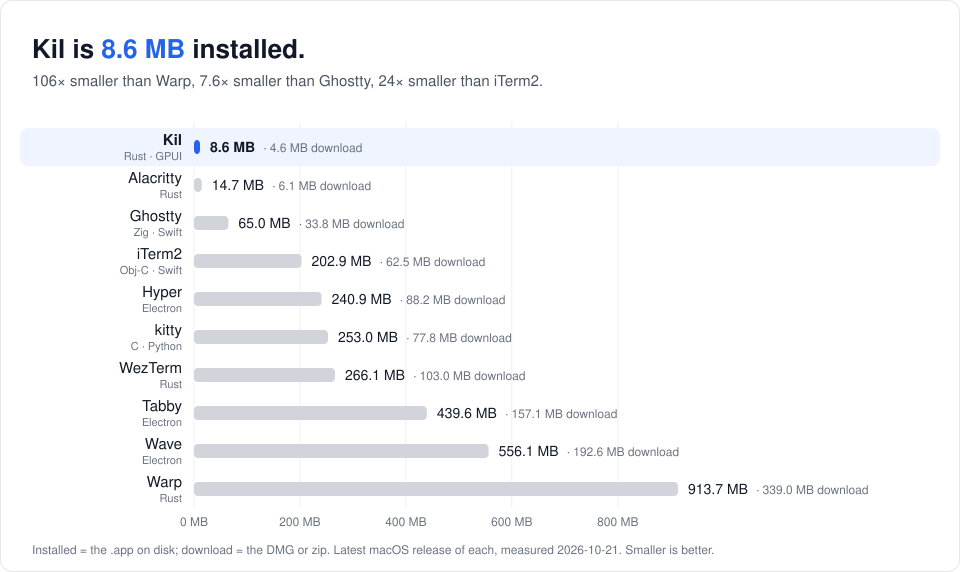

<p align="center">
  
</p>

<h1 align="center">Kil</h1>

[](https://github.com/timwuhaotian/kil/actions/workflows/ci.yml)
[](LICENSE)


Kil is a native macOS terminal emulator written in Rust — a lightweight, fast terminal at 8.6 MB installed, and an iTerm2, Ghostty, and Warp alternative whose session server keeps jobs running across quit or crash. With vertical tabs, animated split panes, 0.00% idle CPU, and per-tab memory display, every pane reattaches to its live process on relaunch.

A native macOS terminal written in Rust. It has vertical tabs, animated split panes and
shortcuts you can rebind. Your jobs keep running after Kil quits or crashes: reopen it and
every pane is back on its live process, with vim's unsaved buffer, the ssh connection and the
half-finished build where you left them.

<p align="center">
  
</p>

Kil is built on [GPUI](https://github.com/zed-industries/zed/tree/main/crates/gpui) (Metal
rendering) and [`alacritty_terminal`](https://github.com/alacritty/alacritty) (VT parsing). It
owns every process, PID and file descriptor it creates.

> **Status: early.** macOS only for now: Apple silicon, macOS 14 or later. It is tested
> on macOS 27.

## Features

- **Vertical tabs** in a sidebar. A ring marks a tab with a running job, and a dot marks one
  whose job finished while you weren't looking. Right-click for **Pin Tab** / **Unpin Tab**:
  pinning moves a tab to the end of the pinned group at the top, and unpinning to the start of
  the unpinned group. Drag a tab up or down to reorder it within its group: it lifts off the
  list and follows the pointer while the others slide out of its way. Pinning and tab order
  survive relaunches. Double-click a tab to rename it (IME works, Chinese included). A new tab
  is named for its folder. How much of the blurred desktop shows through the sidebar is a setting.
- **Notifications from programs.** When a program posts one (OSC 9 or 777: killi, Claude
  Code and others do when a long job ends) and its tab isn't in view, macOS shows it —
  naming the job, tab and folder it came from — and the tab gets the dot; clicking the
  notification brings Kil forward and goes to the pane that sent it. The first one asks
  macOS for permission.
- **Split panes** that animate open and closed, with the keys or the two buttons at the top
  right of the tab. A new pane opens where the pane it split is. They share the tab evenly
  whenever a pane comes or goes. Drag the dividers; the focused pane is the bright one, with
  a thin accent border visible on all four sides, wherever the pane sits.
- **Jobs outlive the window.** A small session server (`kil --server`, the same binary) holds
  every pane's terminal. `⌘Q` and closing the window only detach from it, and so does a crash.
  The next launch goes back on the same processes, with the full screen, scrollback and input
  modes. **Kil ▸ Quit and Stop All Jobs** ends everything, and **Kil ▸ Restart** ends it and
  opens Kil again.
- **Remote panes for Agent on Edge.** Settings ▸ Agent on Edge shows a QR code that pairs an
  iPhone to the same session server through a TLS tunnel, so the panes on the phone are the
  panes on the desk; `kil --remote` does the same from a terminal, and the standalone
  `kil-remote` binary without starting the server.

  The pairing code never expires — the first phone spends it and its token reconnects for as
  long as the bridge runs — and the bridge belongs to Kil rather than to the panel, so closing
  Settings leaves it up; **New QR** makes a fresh certificate, code and port for a second phone
  or a re-pair. Ticking Public internet asks your own router (UPnP) to forward a port and prints
  a QR for the public IP, so the phone works from anywhere — no cloud service or third party is
  involved, and the mapping is removed when the bridge stops.

  While a phone is attached, its tab's row in the sidebar is outlined in the theme's accent and
  carries a small phone badge; when the phone types, both turn solid — driving, not just
  watching — and the pane stays fully usable either way. The phone follows the window's theme
  and pane size as they change. A session server started by an older Kil marks no pane: the panel
  says so, and **Kil ▸ Restart** brings up the new server.
- **Comes back after a restart, too.** The layout, each pane's directory and the window frame
  are saved within 2 s of a change, and each pane's screen and scrollback every 30 s while it
  prints, and at once when you quit. After a logout or a reboot, the processes themselves are
  gone, so each pane's last job is typed into a new shell instead.
- **Idle means idle.** A window with nothing to draw doesn't wake: no CPU at rest, and a
  blinking cursor redraws only itself. Nothing is written to disk unless something changed.
- **Updates itself, and asks.** Kil checks for a new release at launch and every six hours,
  downloads it in the background, and checks its checksum, Developer ID signature and Apple
  notarization. Once it's ready, a window asks whether to update and lists what's new:
  **Restart Now**, or **Later** and it installs when you quit. Jobs keep running across the
  update.
- **Nine themes**, the same skins killi's `/theme` offers: Batman, Iced Coffee, Creamery
  Station, Pastel Tweencore, Cappuccino, Shades of Gray, Off White, Red Orange and Snow and
  Ice, each painted from the skin's own palette. Programs that ask for the terminal's colors,
  like vim deciding between light and dark, are told the theme's.
- **A default directory** for new tabs, if you want one. Splits still open where their pane
  is.
- **Rebindable keys** in `~/.config/kil/keymap.toml` (**Kil ▸ Keyboard Shortcuts…** opens it),
  with the menus showing single-chord bindings (multi-stroke keys and `⌘1…9` work but
  don't display). Settings live in a Settings window (`⌘,`) or
  `~/.config/kil/config.toml`.
- **Strict about processes.** Children get clean descriptors and signal masks. A closed pane is
  hung up, then killed after 3 s if it ignores the hangup. No zombies, no leaked jobs. It is
  covered by integration tests that run real processes.
- **Shows what a pane costs.** The sidebar says how much memory the program in each tab takes,
  with everything it started, and the total for every tab. macOS charges a program's memory to
  the app that started it, so an agent that grows to gigabytes used to be invisible until the
  system said Kil was at fault.

## Size

Kil is the smallest full-featured macOS terminal emulator at 8.6 MB installed — 7.6× smaller than Ghostty (65.0 MB), 24× smaller than iTerm2 (202.9 MB), and 106× smaller than Warp (913.7 MB).

<picture>
  <source media="(prefers-color-scheme: dark)" srcset="docs/size-dark.svg">
  
</picture>

Versions measured: Kil 0.0.10, Alacritty 0.17.0, Ghostty 1.3.1, iTerm2 3.7.6, Hyper 3.4.1,
kitty 0.49.2, WezTerm 20240203, Tabby 1.0.238, Wave 0.14.5, Warp 0.2026.10.14.
Kil, Hyper, Tabby and Wave are measured as their Apple silicon builds. The others ship one
universal app for Intel and Apple silicon, which carries each binary twice. Alacritty is the
only one near Kil's size, and it has no tabs or split panes.

## Kil vs other macOS terminals

Installed sizes come from the chart above; — means not applicable or not disclosed by the project.

| Terminal | Installed size | Language | Tabs + persistence | GPU | Open source |
|---|---|---|---|---|---|
| Kil | 8.6 MB | Rust | Vertical tabs, jobs survive quit/crash | Metal (GPUI) | MIT |
| Alacritty | 14.7 MB | Rust | No tabs or splits | Yes | Apache-2.0 |
| Ghostty | 65.0 MB | Zig | Tabs, no live reattach | Yes | MIT |
| iTerm2 | 202.9 MB | Objective-C | Tabs, no live reattach | Yes (Metal) | GPL |
| kitty | 253.0 MB | C + Python | Tabs, no live reattach | Yes | GPL |
| WezTerm | 266.1 MB | Rust | Tabs, no live reattach | Yes | MIT |
| Warp | 913.7 MB | Rust | Tabs, no live reattach | Yes | — |

## Install

Download [`Kil-arm64.dmg`](https://raw.githubusercontent.com/timwuhaotian/kil/main/releases/Kil-arm64.dmg), always the latest Kil, open it, and drag
**Kil** to **Applications**. The app is signed with a Developer ID and notarized by Apple.
From then on it keeps itself up to date: once a new release is downloaded and checked, a
window asks whether to update to it, with its changelog entries — **Restart Now**, or
**Later** and it installs when you quit Kil. **Kil ▸ Check for Updates…** checks right away
in the same window; once a release is ready, the menu item reads **Restart to Update**
(turn automatic updates off in **Settings ▸ Updates**). `releases/`
also holds the DMG's `.sha256`:

```sh
shasum -a 256 -c Kil-arm64.dmg.sha256
```

## Build from source

You need:
- A Mac with Apple silicon.
- **Xcode** with its Metal toolchain: GPUI compiles its shaders at build time.
- **Rust 1.94** or later (`rustup` is easiest).

```sh
git clone https://github.com/timwuhaotian/kil.git
cd kil
cargo run -p kil --release           # run it straight from the build
```

To get a `Kil.app` with its icon and Info.plist, and install it:

```sh
scripts/bundle.sh release            # → target/release/Kil.app (ad-hoc signed)
ditto target/release/Kil.app /Applications/Kil.app
```

`bundle.sh debug` builds a debug bundle instead. A locally built app is ad-hoc signed, which is
fine on the machine that built it, except that macOS refuses notifications from an app that is
not properly signed, so a program's notifications show only in the released Kil.

### Working on Kil with a coding agent

The repo carries a `/kil-config` skill (`.claude/skills/kil-config/`) for Claude Code and
compatible agents. Asked where the config lives, which keys, themes or commands exist, or how
to rebind a key, it reads `settings.rs`, `keymap.rs` and your own `config.toml` and
`keymap.toml` instead of answering from memory, so it stays right as Kil changes.

### Making a release (maintainers)

Releases are built, signed and notarized locally and committed under `releases/`; CI only
checks pull requests and `main`. [`RELEASING.md`](RELEASING.md) has the steps; the build itself
is `scripts/release.sh` → `releases/Kil-arm64.dmg` + `.sha256` + `latest.toml`, which installed
copies read to find the update.

## Using Kil

| Keys | Action |
|---|---|
| `⌘T` | New tab, in the default directory, else the focused pane's |
| `⌘⇧D` / `⌘D` | Split right / split down |
| `⌘⇧C` / `⌘⇧W` | Close pane / close tab |
| `⌘⌥←→↑↓` | Focus the pane in that direction |
| `⌘1`…`⌘9`, `⌘⇧[` / `⌘⇧]` | Select a tab, previous / next tab |
| `⇧↩` | New line without sending, in Claude Code, kimi and other TUIs (sends ESC CR, like `⌥↩`) |
| `⌘C` / `⌘V` | Copy / paste (bracketed paste when the program asks for it; with an image on the clipboard such a program gets an empty paste, so killi attaches the image) |
| drag a file in | Its path is typed where it lands, shell-escaped; killi attaches an image or names any other file with `@` |
| `⌘K` | Clear scrollback |
| `⌘=` / `⌘-` / `⌘0` | Font bigger / smaller / reset |
| `⌘,` | Settings |
| `⌘Q` | Quit; running jobs keep going |

The **Kil** menu has **Restart** (stop every job, then open Kil again), **Quit and Stop All
Jobs**, and the usual Hide, Hide Others and Show All.

Double-click a tab to rename it (Enter or clicking away saves, Esc cancels), right-click it
for Pin / Unpin / Rename / Close, drag it within its group to reorder, and double-click empty
sidebar space for a new tab (the **New Tab** button at the bottom shows its shortcut when you hover it).
Double-click the top of the sidebar, beside the window buttons, to fill the screen and again
to go back (it does what **System Settings ▸ Desktop & Dock** says a title-bar double-click
does). Programs that report the mouse, like Claude Code's full-screen view, get the scroll
wheel; programs that ask for drags, like killi's fullscreen mode, also get the press, drags
and release and own their selection (Shift-drag stays Kil's). Elsewhere the wheel scrolls
Kil's scrollback. Cmd-click a link — a bare URL, a markdown link's text, or a program's
OSC 8 hyperlink — to open it in the default browser.

**Rebinding is in the app.** **Settings ▸ Keyboard** lists every command and the keys it runs on.
Click a shortcut, press the new one, and it is saved and applied at once — the old keys stop
working, a key another command already has is refused by name, and **Reset** brings the default
back.

**`~/.config/kil/keymap.toml`** overrides any default, and is what the recorder writes. **Kil ▸
Keyboard Shortcuts…** opens it, creating a commented template the first time. Unknown keys or
commands show up in a banner, and the valid entries still apply. It is reloaded when the window
regains focus, and the menu bar then shows the new keys.

```toml
[bindings]
"cmd-y" = "split_right"
"cmd-k" = "unbind"
```

**`~/.config/kil/config.toml`** (`$XDG_CONFIG_HOME` is respected):

```toml
theme = "batman"                       # batman, iced-coffee, creamery-station, pastel-tweencore,
                                       # cappuccino, shades-of-gray, off-white, red-orange or snow-and-ice
font_family = "Menlo"
font_size = 13.0
default_directory = "~/code"     # where new tabs open; leave out to follow the focused pane
scrollback_lines = 10000
option_as_meta = true
cursor_blink = true
sidebar_opacity = 0.6            # 0–1; leave out for the theme's own
auto_update = true               # check, download and install updates when Kil quits
```

**`~/Library/Application Support/kil/`** holds what Kil reopens: `session.toml` (layout),
`panes/` (saved screens) and the session server's socket, lock and log. To start the next
launch fresh, quit with **Quit and Stop All Jobs** and delete `session.toml`.

## How it works

```
crates/
├─ kil-term/   no UI: PTY spawn, process lifecycle, reaper, the pane I/O loop, terminal
│              snapshots, the session server and its client. Unsafe code is Darwin FFI in
│              src/sys/darwin.rs plus a few kqueue registrations, each with a SAFETY comment.
└─ kil/        the GPUI app: window, sidebar, split tree, rendering, input and IME, keymap,
               settings, notifications, saving and restoring the session.
vendor/gpui/   GPUI 0.2.2 with one change of ours: an idle window stops asking for frames.
```

- Each pane's program runs in the **session server**, which owns its PTY and child. The app
  keeps a mirror of each terminal, fed over a Unix socket. On attach the server sends the
  whole terminal: scrollback, screen, the alternate screen, cursor and modes. Throughput and
  keypress echo through the server measure the same as a local session.
- If the server dies, its jobs are hung up, as on a crash. Nothing it started outlives it.
- [`DESIGN.md`](DESIGN.md) has the full design: measured findings about macOS PTYs, the process
  and teardown invariants, the memory and rendering budgets, the session server protocol, and
  the tests behind each claim.

## Development

```sh
cargo test --workspace --locked                              # unit, GPUI and real-process tests
cargo clippy --workspace --all-targets --locked -- -D warnings
cargo +nightly fmt --all                                     # rustfmt.toml uses nightly options
```

The process tests in `crates/kil-term/tests/` spawn real shells and check fds, signals,
reaping, crashes and leaks. They should leave no process behind; if one does, that's a bug.

Contributions are welcome: see [`CONTRIBUTING.md`](CONTRIBUTING.md) and the
[code of conduct](CODE_OF_CONDUCT.md). Report security issues privately, as
[`SECURITY.md`](SECURITY.md) describes. Changes are listed in [`CHANGELOG.md`](CHANGELOG.md).

## FAQ

### What is Kil terminal?

Kil is a native macOS terminal emulator written in Rust, with vertical tabs, animated split panes, and GPU rendering via GPUI and Metal. At 8.6 MB installed, this fast Rust terminal emulator pairs alacritty_terminal parsing with a session server, 9 themes, and rebindable keys.

### How is Kil different from Ghostty, iTerm2, and Warp?

Kil's core difference is live session persistence: jobs outlive the window, so a quit or crash reattaches every pane to its live process with vim buffers, ssh connections, and builds intact. It is also a far smaller fast terminal — 8.6 MB vs Ghostty 65.0 MB, iTerm2 202.9 MB, and Warp 913.7 MB — with 0.00% idle CPU, per-tab memory display, and iPhone remote panes, acting as a built-in tmux alternative without learning tmux commands.

### How big is Kil?

Kil installs at 8.6 MB, the smallest full-featured macOS terminal emulator in the chart above. That is 7.6× smaller than Ghostty (65.0 MB), 24× smaller than iTerm2 (202.9 MB), and 106× smaller than Warp (913.7 MB); only Alacritty (14.7 MB) is close, and it has no tabs or splits.

### Does Kil keep processes running after quit?

Yes — Kil keeps every process running after quit, window close, or crash. Kil is a terminal with session restore built in: a session server (`kil --server`) holds each pane's PTY, so quitting only detaches and the next launch reattaches to the same live PIDs with full screen and scrollback. After a logout or reboot the processes are gone, so each pane retypes its last job into a new shell instead.

### Is Kil free and open source?

Yes — Kil is free and MIT-licensed at github.com/timwuhaotian/kil. It builds on Apache-2.0 GPUI and alacritty_terminal, and the 8.6 MB release build is Developer ID signed and Apple-notarized with automatic updates.

### What platforms does Kil support?

Kil supports Apple silicon Macs on macOS 14 or later (tested on macOS 27); Intel Macs, Linux, and Windows are not supported. It is early-stage, macOS-only software, using native Metal rendering and direct PTY ownership.

### How do I install Kil on macOS?

Download Kil-arm64.dmg from the releases/ folder, open it, and drag Kil to Applications — the signed, notarized app then keeps itself up to date. You need an Apple silicon Mac on macOS 14+; to build from source, clone the repo and run `cargo run -p kil --release` with Rust 1.94+ and Xcode's Metal toolchain.

## License

[MIT](LICENSE). GPUI and `alacritty_terminal` are Apache-2.0.
