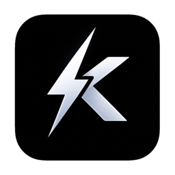
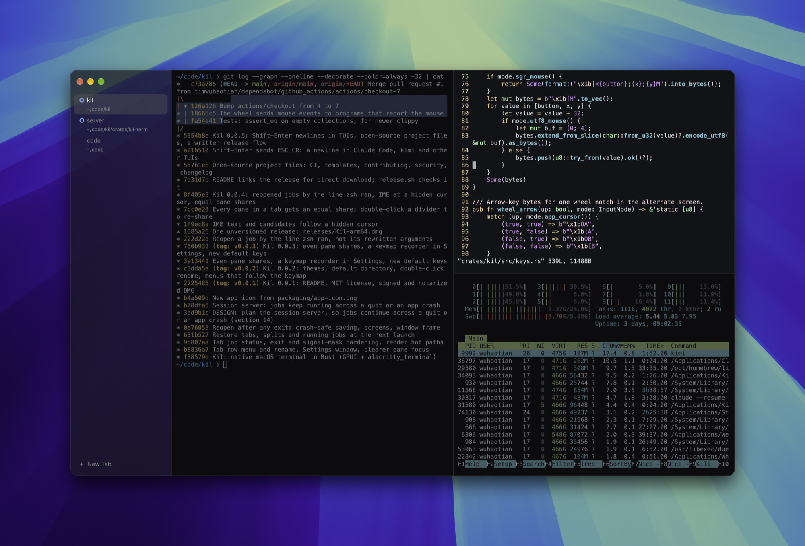

<p align="center">
  
</p>

<h1 align="center">Kil</h1>

[](https://github.com/timwuhaotian/kil/actions/workflows/ci.yml)
[](LICENSE)


A native macOS terminal written in Rust. It has vertical tabs, animated split panes and
shortcuts you can rebind. Your jobs keep running after Kil quits or crashes: reopen it and
every pane is back on its live process, with vim's unsaved buffer, the ssh connection and the
half-finished build where you left them.

<p align="center">
  
</p>

Kil is built on [GPUI](https://github.com/zed-industries/zed/tree/main/crates/gpui) (Metal
rendering) and [`alacritty_terminal`](https://github.com/alacritty/alacritty) (VT parsing). It
owns every process, PID and file descriptor it creates.

> **Status: early.** macOS only for now: Apple silicon, macOS 14 or later. It is tested
> on macOS 27.

## Features

- **Vertical tabs** in a sidebar. A ring marks a tab with a running job, and a dot marks one
  whose job finished while you weren't looking. Drag a tab up or down to reorder it, and
  double-click it to rename it (IME works, Chinese included). How much of the blurred desktop
  shows through the sidebar is a setting.
- **Split panes** that animate open and closed. They share the tab evenly whenever a pane
  comes or goes. Drag the dividers; the focused pane is the bright one.
- **Jobs outlive the window.** A small session server (`kil --server`, the same binary) holds
  every pane's terminal. `⌘Q` and closing the window only detach from it, and so does a crash.
  The next launch goes back on the same processes, with the full screen, scrollback and input
  modes. **Kil ▸ Quit and Stop All Jobs** ends everything.
- **Comes back after a restart, too.** The layout, each pane's directory and the window frame
  are saved within 2 s of a change, and each pane's screen and scrollback every 30 s while it
  prints, and at once when you quit. After a logout or a reboot, the processes themselves are
  gone, so each pane's last job is typed into a new shell instead.
- **Idle means idle.** A window with nothing to draw doesn't wake: no CPU at rest, and a
  blinking cursor redraws only itself. Nothing is written to disk unless something changed.
- **Updates itself, quietly.** Kil checks for a new release at launch and every six hours,
  downloads it in the background, checks its checksum, Developer ID signature and Apple
  notarization, and installs it when you quit. Jobs keep running across the update.
- **Five themes**: Night, Paper (light), Fjord, Ember and Dusk. Programs that ask for the
  terminal's colors, like vim deciding between light and dark, are told the theme's.
- **A default directory** for new tabs, if you want one. Splits still open where their pane
  is.
- **Rebindable keys** in `~/.config/kil/keymap.toml` (**Kil ▸ Keyboard Shortcuts…** opens it),
  with the menus showing whatever is bound. Settings live in a Settings window (`⌘,`) or
  `~/.config/kil/config.toml`.
- **Strict about processes.** Children get clean descriptors and signal masks. A closed pane is
  hung up, then killed after 3 s if it ignores the hangup. No zombies, no leaked jobs. It is
  covered by integration tests that run real processes.
- **Shows what a pane costs.** The sidebar says how much memory the program in each tab takes,
  with everything it started, and the total for every tab. macOS charges a program's memory to
  the app that started it, so an agent that grows to gigabytes used to be invisible until the
  system said Kil was at fault.

## Install

Download [`Kil-arm64.dmg`](https://github.com/timwuhaotian/kil/raw/main/releases/Kil-arm64.dmg), always the latest Kil, open it, and drag
**Kil** to **Applications**. The app is signed with a Developer ID and notarized by Apple.
From then on it keeps itself up to date: a new release is installed when you quit Kil, and
**Kil ▸ Check for Updates…** checks right away, in a small window that shows the download
and offers **Restart Now** or **Later** (turn automatic updates off in **Settings ▸ Updates**). `releases/` also holds the DMG's `.sha256`:

```sh
shasum -a 256 -c Kil-arm64.dmg.sha256
```

## Build from source

You need:
- A Mac with Apple silicon.
- **Xcode** with its Metal toolchain: GPUI compiles its shaders at build time.
- **Rust 1.94** or later (`rustup` is easiest).

```sh
git clone https://github.com/timwuhaotian/kil.git
cd kil
cargo run -p kil --release           # run it straight from the build
```

To get a `Kil.app` with its icon and Info.plist, and install it:

```sh
scripts/bundle.sh release            # → target/release/Kil.app (ad-hoc signed)
ditto target/release/Kil.app /Applications/Kil.app
```

`bundle.sh debug` builds a debug bundle instead. A locally built app is ad-hoc signed, which is
fine on the machine that built it.

### Making a release (maintainers)

Releases are built, signed and notarized locally and committed under `releases/`; CI only
checks pull requests and `main`. [`RELEASING.md`](RELEASING.md) has the steps; the build itself
is `scripts/release.sh` → `releases/Kil-arm64.dmg` + `.sha256` + `latest.toml`, which installed
copies read to find the update.

## Using Kil

| Keys | Action |
|---|---|
| `⌘T` | New tab, in the default directory, else the focused pane's |
| `⌘⇧D` / `⌘D` | Split right / split down |
| `⌘⇧C` / `⌘⇧W` | Close pane / close tab |
| `⌘⌥←→↑↓` | Focus the pane in that direction |
| `⌘1`…`⌘9`, `⌘⇧[` / `⌘⇧]` | Select a tab, previous / next tab |
| `⇧↩` | New line without sending, in Claude Code, kimi and other TUIs (sends ESC CR, like `⌥↩`) |
| `⌘C` / `⌘V` | Copy / paste (bracketed paste when the program asks for it) |
| `⌘K` | Clear scrollback |
| `⌘=` / `⌘-` / `⌘0` | Font bigger / smaller / reset |
| `⌘,` | Settings |
| `⌘Q` | Quit; running jobs keep going |

Double-click a tab to rename it (Enter or clicking away saves, Esc cancels), right-click it
for Rename / Close, drag it up or down to reorder, and double-click empty sidebar space for a
new tab. Double-click the top of the sidebar, beside the window buttons, to fill the screen
and again to go back (it does what **System Settings ▸ Desktop & Dock** says a title-bar
double-click does). Programs that report the mouse, like Claude Code's full-screen view, get
the scroll wheel; elsewhere it scrolls Kil's scrollback.

**Rebinding is in the app.** **Settings ▸ Keyboard** lists every command and the keys it runs on.
Click a shortcut, press the new one, and it is saved and applied at once — the old keys stop
working, a key another command already has is refused by name, and **Reset** brings the default
back.

**`~/.config/kil/keymap.toml`** overrides any default, and is what the recorder writes. **Kil ▸
Keyboard Shortcuts…** opens it, creating a commented template the first time. Unknown keys or
commands show up in a banner, and the valid entries still apply. It is reloaded when the window
regains focus, and the menu bar then shows the new keys.

```toml
[bindings]
"cmd-y" = "split_right"
"cmd-k" = "unbind"
```

**`~/.config/kil/config.toml`** (`$XDG_CONFIG_HOME` is respected):

```toml
theme = "night"                  # night, paper, fjord, ember or dusk
font_family = "Menlo"
font_size = 13.0
default_directory = "~/code"     # where new tabs open; leave out to follow the focused pane
scrollback_lines = 10000
option_as_meta = true
cursor_blink = true
sidebar_opacity = 0.6            # 0–1; leave out for the theme's own
auto_update = true               # check, download and install updates when Kil quits
```

**`~/Library/Application Support/kil/`** holds what Kil reopens: `session.toml` (layout),
`panes/` (saved screens) and the session server's socket, lock and log. To start the next
launch fresh, quit with **Quit and Stop All Jobs** and delete `session.toml`.

## How it works

```
crates/
├─ kil-term/   no UI: PTY spawn, process lifecycle, reaper, the pane I/O loop, terminal
│              snapshots, the session server and its client. Unsafe code is Darwin FFI in
│              src/sys/darwin.rs plus a few kqueue registrations, each with a SAFETY comment.
└─ kil/        the GPUI app: window, sidebar, split tree, rendering, input and IME, keymap,
               settings, saving and restoring the session.
vendor/gpui/   GPUI 0.2.2 with one change of ours: an idle window stops asking for frames.
```

- Each pane's program runs in the **session server**, which owns its PTY and child. The app
  keeps a mirror of each terminal, fed over a Unix socket. On attach the server sends the
  whole terminal: scrollback, screen, the alternate screen, cursor and modes. Throughput and
  keypress echo through the server measure the same as a local session.
- If the server dies, its jobs are hung up, as on a crash. Nothing it started outlives it.
- [`DESIGN.md`](DESIGN.md) has the full design: measured findings about macOS PTYs, the process
  and teardown invariants, the memory and rendering budgets, the session server protocol, and
  the tests behind each claim.

## Development

```sh
cargo test --workspace --locked                              # unit, GPUI and real-process tests
cargo clippy --workspace --all-targets --locked -- -D warnings
cargo +nightly fmt --all                                     # rustfmt.toml uses nightly options
```

The process tests in `crates/kil-term/tests/` spawn real shells and check fds, signals,
reaping, crashes and leaks. They should leave no process behind; if one does, that's a bug.

Contributions are welcome: see [`CONTRIBUTING.md`](CONTRIBUTING.md) and the
[code of conduct](CODE_OF_CONDUCT.md). Report security issues privately, as
[`SECURITY.md`](SECURITY.md) describes. Changes are listed in [`CHANGELOG.md`](CHANGELOG.md).

## License

[MIT](LICENSE). GPUI and `alacritty_terminal` are Apache-2.0.
